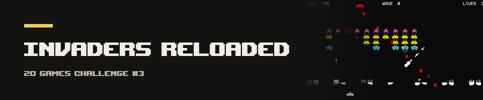
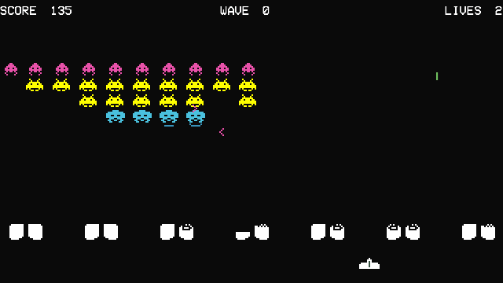
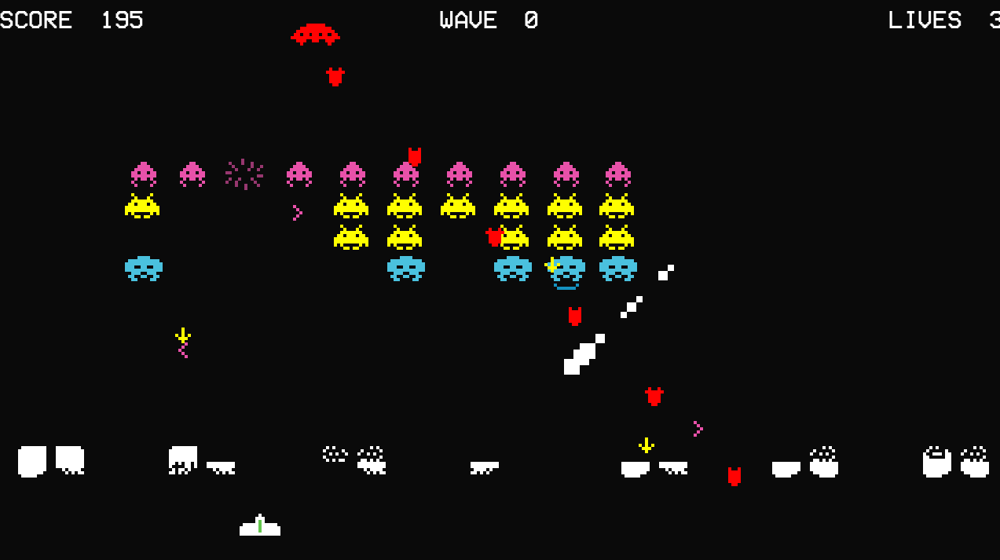
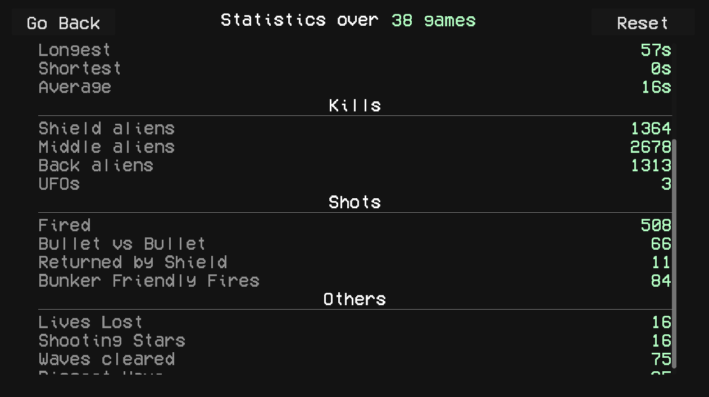

# Invaders Reloaded



A small fixed-shooter made with Godot 4.5: a wave of aliens marches down the screen, you slide left and right
under your bunkers and shoot them before they land.

I made it in about a week in November 2025, as the third game of my
[20 Games Challenge](https://20_games_challenge.gitlab.io/), where you remake a list of classic games to learn how
they're built. I kept the classic formula and added a few things of my own on top.

**Play it in your browser: https://kozumagames.itch.io/invaders-reloaded**



## What's different

- **Shield aliens.** The front row doesn't shoot. It raises a shield, and a bullet that hits it comes back down
  at you, slower, as an enemy bullet.
- **Bullets collide.** Your shot can hit an enemy bullet in the air, and both blow up.
- **Your bunkers aren't on your side.** Your own bullets chip them away just like the aliens' do.
- **The UFO** shows up after a number of your shots, not on a timer. It drops bombs that hit bunkers harder.
- **Each wave shoots more.** When a wave is cleared, the next one spawns with shorter cooldowns, down to a
  limit. Inside a wave, the march speeds up every time it hits a wall.
- **Statistics.** The game keeps track of everything across games: scores, playtime, kills per alien type, shots
  fired, bullets clashed, shots sent back by a shield, bunker friendly fire, lives lost, and the shooting stars
  that sometimes cross the background.





The pause menu has a volume slider and a colour slider for your ship and bullets.

## Controls

| Key | Does |
| --- | --- |
| `A` `D` or `←` `→` | move |
| `Space`, `W` or `↑` | shoot |
| `Esc` | pause |

You have 3 lives. The game ends when you lose them all or when the aliens reach your bunkers.

## Running it

The [itch.io page](https://kozumagames.itch.io/invaders-reloaded) has the web version and downloads for Windows and
Linux.

To run it from source, you need [Godot 4.5](https://godotengine.org/download/archive/) (the standard version,
not .NET).

```
git clone https://github.com/Nabil080/invaders-reloaded.git
```

Open the folder from the Godot project manager and press `F5`. The project has export presets for Windows,
Linux and the web if you want to build it.

The tests run headless, from the project folder, once the project has been imported (opened once in the editor,
or `godot --headless --import`):

```
godot --headless --script res://tests/test_save_data.gd
```

## How it's organised

- `core/`: the game scene, the player, the enemy manager (spawning, marching, difficulty) and the save
- `enemies/`, `bullets/`, `bunkers/`: one scene each; aliens and bullets have their stats in `resources/`
- `UI/`: menus, HUD and the statistics page
- `assets/`: sprites, sounds and the font

The aliens and bullets get their stats from resources (`EnemyData`, `BulletData`), so tuning them doesn't touch
the code. The statistics are saved to `user://SaveFile.tres`.

## Credits

- Font: [VCR OSD Mono](https://www.dafont.com/vcr-osd-mono.font) by Riciery Leal
- Shooting star and starry background: [Free Falling Star animation](https://pixel-salvaje.itch.io/free-falling-star-animation) by pixel_Salvaje
- `explosionCrunch_001`, `forceField_000`, `spaceEngine_000`: [Sci-fi Sounds](https://kenney.nl/assets/sci-fi-sounds) by Kenney (CC0)
